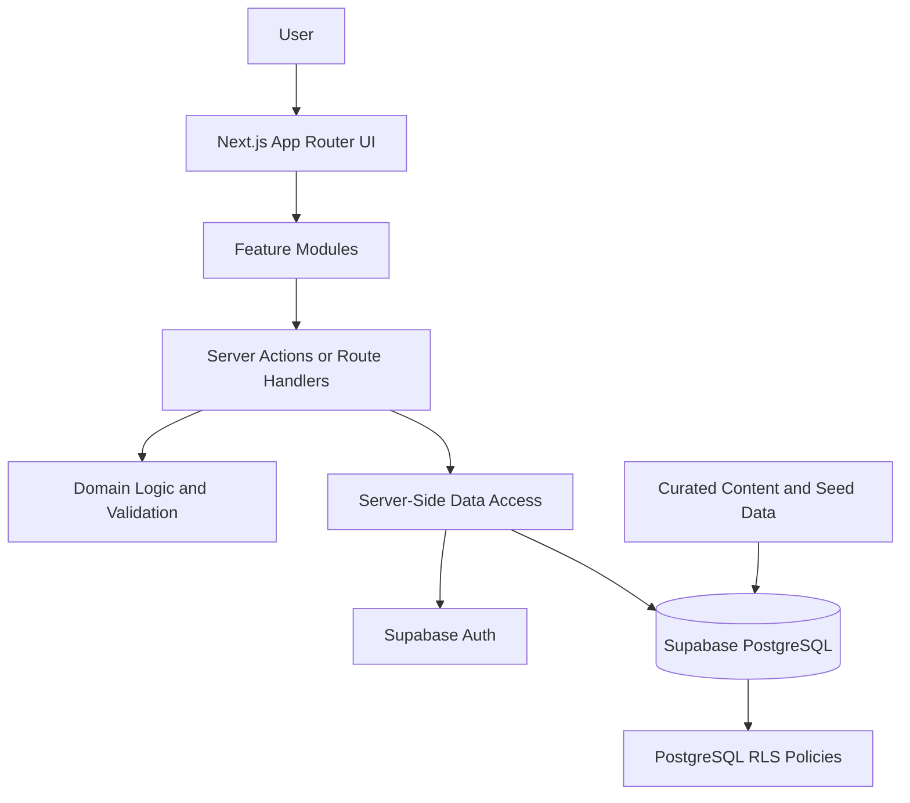
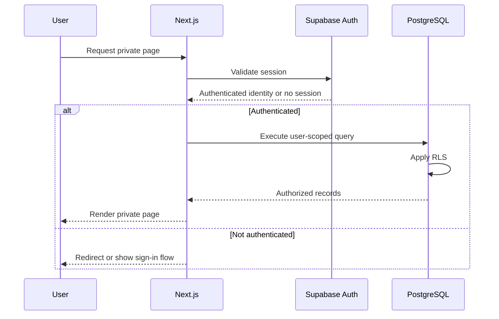

# 07 — Application Architecture

**Project:** Tamil Nadu Fitness Companion  
**Document:** Application Architecture  
**Status:** Ready for Antigravity review  
**Frontend:** Next.js App Router, React, TypeScript  
**UI:** Tailwind CSS, shadcn/ui  
**Backend platform:** Supabase  
**Database:** PostgreSQL  
**Authentication:** Supabase Auth  
**Deployment target:** Vercel-compatible Next.js deployment  
**Initial language:** English

---

## 1. Purpose

This document defines the high-level architecture of the Tamil Nadu Fitness Companion.

It establishes how the application's pages, reusable components, business logic, authentication, data access, database, and security controls fit together.

The architecture must support:

- A calorie calculator with appropriate input validation and safety guardrails.
- Curated workout templates and editable personal workout plans.
- Exercise-based performance history.
- Habit tracking and consecutive-day streaks.
- A Tamil Nadu-oriented food catalogue and meal-plan calculations.
- Private, user-owned data protected by server-side authorization and PostgreSQL Row Level Security (RLS).
- Future Tamil localization.
- Maintainable code, testable domain logic, and reliable deployment.

This architecture supports the approved PRD, user stories, information architecture, UI/UX specification, domain logic, and content specification.

It does not replace those documents.

## 2. Architectural principles

### 2.1 Modular monolith

Build the first release as a single Next.js application with clearly separated feature modules.

Do not introduce microservices, a separate backend application, or additional infrastructure unless a documented requirement justifies the complexity.

The application should have one coherent deployment unit and explicit boundaries between features.

### 2.2 Secure by default

Authentication is required for private application features.

Authorization must be enforced by trusted server-side logic and database policies. Hiding a button, protecting a client-side route, or checking whether a user is signed in only in the browser is not sufficient.

Supabase RLS must protect user-owned records even when a request bypasses the normal UI.

### 2.3 Domain logic independent of presentation

Calculations and business rules must not be implemented exclusively inside React components.

Put reusable rules in appropriately organized domain modules so they can be tested without rendering the interface.

This includes calorie calculations, workout prescription validation, food-portion calculations, progress-log validation, and habit-streak calculations.

### 2.4 Database as the persistent source of truth

Use PostgreSQL through Supabase for persistent curated content and user-owned application records as defined by the database specification.

React component state may hold temporary UI state, but it must not replace persistence for workout history, habit logs, personal plans, or other saved data.

### 2.5 Explicit contracts

Pages and components should not issue arbitrary database operations throughout the application.

Use a consistent, typed data-access layer and documented contracts between UI features, server-side operations, and database functions.

### 2.6 Preserve user history

Changes to a current workout plan must not silently erase historical exercise progress.

Changes to curated content must not unintentionally overwrite user-owned data.

Deletion and retention behavior must follow the approved product, domain-logic, security, and database specifications.

---

## 3. High-level system architecture

The application consists of the following layers.



This diagram describes logical responsibilities, not a requirement that every read must pass through an HTTP endpoint. Server Components may fetch data through approved server-side data-access functions when that fits the operation.

Browser-originated requests must never receive elevated database privileges.

### 3.1 Layer responsibilities

| Layer | Responsibility |
|---|---|
| App Router | Page routing, layouts, loading and error boundaries |
| UI components | Display data, accept input, and communicate UI state |
| Feature modules | Organize feature-specific pages, components, and operations |
| Server operations | Execute trusted mutations and protected operations |
| Domain logic | Apply deterministic business rules and validation |
| Data-access layer | Perform authorized database reads and writes |
| Supabase Auth | Establish and validate authenticated user identity |
| PostgreSQL | Persist application data and enforce relational constraints |
| RLS | Enforce database-level access restrictions |
| Content seeding | Load approved, version-controlled starter content |

Do not merge all responsibilities into one large page, one generic API handler, or one oversized utility module.

---

## 4. Technology responsibilities

### 4.1 Next.js App Router

Next.js provides:

- Application routing.
- Layouts shared between related pages.
- Server-side rendering and Server Components where appropriate.
- Client Components for interactive UI.
- Server Actions or Route Handlers for suitable mutations and endpoints.
- Loading, error, and not-found boundaries.

Use the project's existing Next.js version and established conventions. Do not upgrade major framework versions solely to follow an architectural preference.

The exact choice between Server Actions and Route Handlers should be made consistently for each operation and documented in the API specification.

### 4.2 TypeScript

Use TypeScript throughout the application.

Requirements:

- Keep domain types explicit.
- Avoid `any` when a proper type can be defined.
- Validate external data at runtime instead of assuming that TypeScript alone guarantees validity.
- Reuse generated Supabase database types where appropriate.
- Keep API request and response types consistent with runtime validation.
- Represent genuinely optional or missing source data correctly.

A database type does not replace validation of untrusted form submissions or external input.

### 4.3 Tailwind CSS and shadcn/ui

Use Tailwind CSS and shadcn/ui to build a consistent, accessible interface.

Shared components should cover common needs such as form fields, buttons, dialogs, tables, cards, navigation, empty states, and feedback messages.

Use feature-specific components when the behavior belongs to one domain.

Avoid duplicating nearly identical styling or interaction logic across all five feature areas.

### 4.4 Supabase

Supabase provides:

- Authentication.
- PostgreSQL persistence.
- Database-level security through RLS.
- Approved database functions for operations requiring database-side atomicity.

Do not introduce Supabase Edge Functions, Realtime subscriptions, Storage buckets, or additional Supabase products unless an actual requirement warrants them.

### 4.5 React Hook Form and Zod

Use React Hook Form for suitable complex interactive forms and Zod for runtime validation.

Validation should be shared or aligned between client and server when appropriate.

Client validation improves usability. Server-side validation remains mandatory for trusted mutations.

### 4.6 Recharts

Use Recharts for applicable exercise-progress visualizations.

Charts must consume validated, correctly scoped progress records. They must handle empty history, invalid or missing measurements, and insufficient data without fabricating points or trends.

A chart is a presentation of stored data, not the authoritative record of that data.

---

## 5. Route and feature architecture

The application has five primary navigation destinations:

1. Calorie Calculator.
2. Workout Plans.
3. My Workout Plan.
4. Habit Tracker.
5. Diet Foods.

Preserve the approved information architecture and existing route definitions.

Conceptually, the private application includes the following areas:

| Feature | Main responsibility |
|---|---|
| Calorie Calculator | Collect required inputs, validate them, calculate estimates, and explain results |
| Workout Plans | Browse curated templates and inspect their source-provided workout content |
| My Workout Plan | Manage personal plans, days, exercises, and user-configured prescriptions |
| Workout Progress | Record and review performance for individual exercises |
| Habit Tracker | Manage personal habits, completion history, and streaks |
| Diet Foods | Search food records, select portions, and calculate nutrition totals |
| Settings | Manage applicable preferences, account actions, data export, and account deletion |

The exercise-progress route must remain independent of the current workout-plan structure. Use the approved route `/app/workout-progress/[exerciseId]` unless the information architecture is explicitly revised.

Progress history must not become inaccessible merely because the user removes an exercise from a particular plan.

The actual full route tree is maintained in `docs/03-information-architecture.md`.

---

## 6. Feature-module boundaries

Organize application code by responsibility rather than placing all components, database queries, and business rules in shared global folders.

A conceptual module layout is:

```text
src/
  app/
    (public)/
    (auth)/
    app/
      calorie-calculator/
      workout-plans/
      my-workout-plan/
      workout-progress/
      habit-tracker/
      diet-foods/
      settings/
  components/
    ui/
    layout/
    shared/
  features/
    calorie-calculator/
    workouts/
    workout-progress/
    habits/
    nutrition/
    settings/
  lib/
    supabase/
      browser-client.ts
      server-client.ts
    validation/
    utils/
  server/
    data-access/
    operations/
  domain/
    calorie-calculator/
    workouts/
    workout-progress/
    habits/
    nutrition/
  types/
```

This layout is illustrative. Adapt it to the existing repository instead of blindly duplicating folders or moving working code without a reason.

The implementation must preserve a clear distinction between client-safe modules and modules that use privileged server-side capabilities.

### 6.1 Calorie calculator module

Responsibilities:

- Collect and validate calculator inputs.
- Apply the approved domain calculation.
- Handle unsupported or invalid inputs.
- Apply the under-18 restriction.
- Apply approved calorie-target guardrails.
- Display the result, units, estimate limitations, and disclaimer.

Calculation rules must come from `docs/05-domain-logic.md`. Do not duplicate formula implementations separately in forms, result cards, and other components.

The calculator must not silently alter an unsafe or invalid result to make it appear acceptable.

### 6.2 Workout module

Responsibilities:

- Browse curated workout templates.
- Display source-provided day and exercise information.
- Expose valid source links.
- Copy templates into private personal plans.
- Support approved Replace and Merge operations.
- Validate personal exercise prescriptions.

Curated content and personal plan content must remain separate.

### 6.3 Workout-progress module

Responsibilities:

- Record a user's exercise performance.
- Retrieve history for the intended exercise and current user.
- Present historical measurements and trends where data supports them.
- Handle missing measurements and empty histories.

Progress logs must be associated with the authenticated owner and the appropriate exercise identity, rather than requiring a currently existing workout-plan entry.

### 6.4 Habit module

Responsibilities:

- Create, rename, and manage personal habits according to product requirements.
- Record completion by calendar date.
- Display current and best streaks.
- Respect the user's configured IANA timezone, with `Asia/Kolkata` as the established default.

Streak calculation must use the domain logic defined in `docs/05-domain-logic.md`.

The UI must not independently calculate a different streak from the value returned by trusted domain logic.

### 6.5 Nutrition module

Responsibilities:

- Search and display curated foods.
- Preserve nutrient source and data-quality labels.
- Accept valid portions and units.
- Calculate nutrient contributions from supported source values.
- Report approximate or incomplete totals accurately.

The nutrition module must not treat unknown nutrient values as zero or present approximate records as guaranteed exact measurements.

---

## 7. Rendering and client/server boundaries

### 7.1 Server Components by default

Prefer Server Components for pages and content that do not need browser-only interaction.

This helps keep server-side access logic out of the browser bundle and reduces unnecessary client-side JavaScript.

Use Client Components when genuinely required for interactions such as:

- Form state.
- Dialogs and menus.
- Interactive charts.
- Habit completion controls.
- Dynamic meal-portion editing.
- Client-side feedback and local UI state.

Do not convert the entire application to Client Components merely because one section requires interaction.

### 7.2 Server-side mutations

Use approved Server Actions or Route Handlers for protected mutations as defined in the API specification.

Each trusted mutation must:

1. Establish the current authenticated identity.
2. Validate the operation and submitted data.
3. Enforce ownership and authorization.
4. Apply relevant business rules.
5. Execute the persistence operation.
6. Return a typed, non-sensitive result.
7. Handle expected failures without exposing internal information.

A request must not be trusted because it originated from a visible application button.

### 7.3 Client-to-database access

The application may use a Supabase browser client for supported client-side functionality, but browser-originated access must remain restricted by authentication and RLS.

Sensitive mutations, atomic multi-record operations, and privileged tasks must use the approved server-side path.

Never expose a secret or service-role key in client code, browser environment variables, rendered HTML, or client network responses.

### 7.4 Avoid duplicate sources of truth

Do not independently store competing authoritative copies of the same result in several layers.

For example:

- The database owns persisted workout logs.
- The domain module defines the progress calculations.
- The UI displays the returned and validated result.
- Temporary form values remain local until submitted.

Use cache revalidation or explicit client-data refreshes where necessary so the interface reflects successful mutations.

---

## 8. Supabase client architecture

The application must distinguish between browser and server access.

### 8.1 Browser client

Use the project's approved browser-client factory for supported browser operations.

The browser bundle may contain only the public Supabase project URL and the appropriate public client key.

Treat all browser input as untrusted. RLS must enforce database access restrictions.

### 8.2 Server client

Use a server-only Supabase client configured for the current request and the project's authentication/session conventions.

For user-scoped operations, the client must execute as the authenticated user so PostgreSQL RLS can apply the correct policies.

Do not accidentally run ordinary user-data queries using elevated service-role privileges.

### 8.3 Service-role access

The service-role key bypasses normal RLS protections and must be treated as highly privileged.

Use it only for explicitly authorized server-side administrative operations when genuinely required.

Where service-role access is necessary:

- Keep the key exclusively in protected server-side environment configuration.
- Isolate the privileged code path.
- Validate authorization and input before executing operations.
- Limit the operation to the minimum required capability.
- Never return the key or other privileged configuration to a client.

A service-role key must not be used to compensate for missing or incorrect RLS policies.

### 8.4 Database types and validation

Use Supabase-generated TypeScript types where practical.

Regenerate them through an established process when database schema changes are approved.

Keep runtime validation for user input and external values. Generated types do not validate data received at runtime.

---

## 9. Authentication and authorization flow

All private application data must be associated with the authenticated user.

The logical flow is:



This is a conceptual flow; the precise authentication integration must follow the current project's supported Supabase/Next.js pattern.

### 9.1 Page access

Private pages must validate the current session and follow the approved unauthenticated redirect behavior.

Client-side route guards may improve usability but are not the authoritative security boundary.

### 9.2 Mutation access

For every mutation, verify the current identity server-side and ensure the user is permitted to perform the requested action.

Do not accept a user ID from the request body as proof of ownership.

Where a record already belongs to a user, its existing ownership and database constraints must be used to authorize the operation.

### 9.3 Ownership hierarchy

User-owned records must remain isolated from records belonging to other users.

A child record's authorization must account for its relationship to the parent record. Do not assume that validating the child row's fields alone proves ownership.

For example, a workout-plan entry must not be moved to another user's plan by submitting a different parent ID.

The RLS and schema specifications must define how such relationships are enforced.

---

## 10. Domain logic and transaction boundaries

### 10.1 Single implementation of business rules

Keep deterministic business calculations in reusable domain modules rather than reimplementing them in pages or database query builders.

Use appropriate unit tests to confirm the required behavior.

Where a rule depends on persisted data or concurrent writes, use the appropriate database constraints, transaction, or trusted database function in addition to application-level validation.

### 10.2 Replace and Merge operations

Applying a template to a personal plan may modify several related records.

The operation must avoid partially applying the change if a later part fails.

Use the approved transactional database operation, such as a PostgreSQL function/RPC, where required by the implementation plan.

The transaction must:

- Validate the target plan and its ownership.
- Apply the requested Replace or Merge behavior.
- Prevent unintended duplicate insertions on retries.
- Preserve legitimate exercise use across different days.
- Preserve historical workout progress.
- Roll back the grouped operation if the transaction fails.

Do not implement complex multi-step mutations as unrelated client-side database writes with no atomicity guarantee.

### 10.3 Habit logging

Habit completion must use the authenticated owner, the target habit, and a date-only value.

Enforce the approved uniqueness rule for each habit and calendar date.

The implementation must handle repeated requests without producing duplicate completions for the same habit/date combination.

The configured timezone and date-only semantics must be consistent across writes, reads, and streak calculations.

### 10.4 Progress logs

Exercise-progress records belong to a user and an exercise identity.

They must not depend exclusively on the existence of the plan entry from which the exercise was originally selected.

Updating or deleting a plan entry must not silently remove those records.

### 10.5 Food calculations

Perform nutrient scaling with validated values, compatible units, and a documented reference basis.

The calculation layer must preserve missing-value and approximation states rather than silently producing a false exact total.

---

## 11. Data ownership and persistence

The data model is defined in `docs/08-database.md`. At the architectural level, maintain the following separation.

### 11.1 Curated content

Examples include:

- Exercises.
- Warm-ups.
- Workout templates, days, and template entries.
- Food records and source metadata.

Curated content is maintained through approved seed or content-update processes.

### 11.2 User-owned data

Examples include:

- User profiles and preferences.
- Personal workout plans, days, and entries.
- Workout-progress logs.
- Habits and habit-completion history.
- Personal meal plans and meal items.

These records must have clear ownership and appropriate RLS policies.

### 11.3 Referential integrity

Use appropriate database relationships and constraints to preserve valid references.

If content referenced by historical records changes, behavior must follow the approved schema and retention rules rather than silently invalidating history.

### 11.4 User identity lifecycle

Account creation, profile creation, deletion, export, and other identity-related operations must follow the dedicated authentication, database, and security specifications.

Do not assume that deleting a user from one application table automatically deletes every related record safely.

---

## 12. Error handling and user feedback

The architecture must distinguish expected user-facing errors from unexpected system failures.

### 12.1 Expected errors

Examples include:

- Invalid form input.
- Missing required values.
- Unsupported calculator age.
- An unavailable or invalid source record.
- A missing personal workout plan.
- A failed ownership check.
- A duplicate habit-completion request.
- Incomplete food nutrient information.

Represent these errors in a typed and predictable way where appropriate.

### 12.2 Unexpected errors

Unexpected failures must be handled using the framework's error-handling mechanisms and server-side observability.

User-facing messages should be actionable without exposing:

- Secret keys.
- SQL query details.
- Internal stack traces.
- Sensitive personal data.
- Authentication tokens.
- Database credentials.

### 12.3 Loading, empty, and success states

Each major page must support its required loading, empty, error, and success states as defined by the UI/UX and test-plan documents.

Do not make an empty state look like a server failure or show a success message before a mutation has succeeded.

### 12.4 Logging

Prefer structured, privacy-conscious logs.

Record enough operational context to investigate errors while avoiding unnecessary personal, authentication, or health-related information.

The deployment and security documents define the detailed logging and monitoring requirements.

---

## 13. Environment configuration

Environment variables must be documented, validated, and separated by purpose.

Use the appropriate configuration for:

- Supabase project URL.
- Public Supabase client key.
- Server-only secret keys, only when specifically required.
- Test and deployment environments.
- Other external configuration, if introduced and approved.

Never commit secret values to source control.

Never name a secret in a way that causes Next.js to expose it as a public environment variable.

Public variables are not trusted merely because they are defined through environment configuration.

The actual variable names, required-value validation, and deployment-specific setup belong in the DevOps and security documents.

---

## 14. Testing architecture

Testing must cover business rules and system boundaries, not only visual rendering.

### 14.1 Unit tests

Test deterministic domain behavior independently of the UI.

Examples:

- Calorie calculations and input boundaries.
- Exercise prescription validation.
- Nutrition scaling and missing-value handling.
- Habit streak calculations.
- Progress-data calculations.

Use documented expected outputs and boundary cases.

### 14.2 Integration tests

Test the interaction between application services and persistence where appropriate.

Examples:

- User-owned plan creation and updates.
- Transactional Replace and Merge behavior.
- Idempotent habit logging.
- Progress history surviving plan changes.
- RLS preventing cross-user data access.
- Seed operations remaining repeatable.

### 14.3 End-to-end tests

Test the main user journeys through the actual application interface, including authentication and data persistence.

The dedicated test plan defines the detailed scenarios and acceptance criteria.

### 14.4 Security tests

Test authorization at both the application and database boundaries.

A page passing its access check must not be treated as proof that every database query and mutation is correctly authorized.

---

## 15. Deployment and maintainability

The app should remain compatible with the approved Vercel deployment workflow and Supabase environment.

Maintain a clear separation between development, testing, and production configuration where those environments are available.

Database schema migrations must be version controlled.

Changes to schema, domain logic, and RLS policies must be reviewed and tested together.

Content seeding must not reset production user data.

The detailed migration procedure, environment setup, deployment checks, and recovery strategy are defined in `docs/12-devops.md`.

---

## 16. Architectural decisions and constraints

| Decision | Requirement |
|---|---|
| Application structure | One Next.js modular monolith |
| Frontend language | TypeScript |
| Backend platform | Supabase |
| Persistent storage | PostgreSQL |
| Authentication | Supabase Auth |
| Database isolation | PostgreSQL RLS plus appropriate server-side authorization |
| Shared UI | Tailwind CSS and shadcn/ui |
| Interactive forms | React Hook Form and Zod where suitable |
| Progress visualization | Recharts where appropriate |
| Workout history | Independent of the current plan-entry structure |
| Curated content | Separate from user-owned editable content |
| Atomic plan application | Transactional operation for Replace and Merge |
| Habit dates | Date-only, consistent with the user's configured timezone |
| Initial localization | English, structured for future Tamil support |
| Deployment | Vercel-compatible Next.js deployment |
| Additional infrastructure | Introduce only when a documented requirement justifies it |

These are the architectural constraints for the first release. Any proposed change must identify the requirement it addresses and the impact on security, complexity, testing, and existing documents.

---

## 17. Definition of done

The architecture is ready for implementation when:

1. The five primary feature areas have clear module boundaries.
2. Private data access consistently uses the authenticated identity.
3. User-owned records are protected by appropriate RLS policies.
4. No privileged credentials are exposed to the browser.
5. Domain calculations are centralized and testable.
6. Multi-record mutations use the required transactional behavior.
7. Workout-progress history remains accessible independently of the current plan.
8. Curated content and user-owned content cannot accidentally overwrite one another.
9. Errors, loading states, and empty states are handled consistently.
10. Environment configuration and database migrations follow the approved operational process.
11. Testable contracts connect UI features, domain rules, persistence, and security controls.
12. The architecture is consistent with Documents 01–06 and the approved implementation plan.

**Implementation rule:** If Antigravity identifies a conflict between this document and an approved earlier document, report the exact conflict and propose the smallest correction. Do not silently change product behavior, invent missing source content, or begin application implementation during the documentation-review phase.
