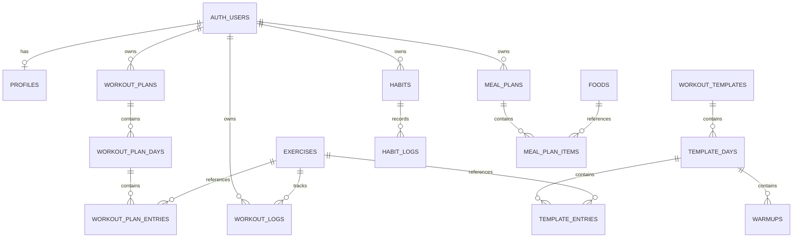

# 08 — Database Design and Data Model

**Project:** Tamil Nadu Fitness Companion  
**Document:** Database Specification  
**Status:** Ready for Antigravity review  
**Database:** Supabase PostgreSQL  
**Authentication:** Supabase Auth  
**Security model:** PostgreSQL Row Level Security (RLS)  
**Primary identifier:** UUID  
**Canonical internal units:** kg, cm, kcal, and g where applicable  
**Default user timezone:** Asia/Kolkata

---

## 1. Purpose

This document defines the database structure, table responsibilities, relationships, constraints, data ownership, indexes, and persistence rules for the Tamil Nadu Fitness Companion.

The database must support:

1. User profiles and preferences.
2. Curated exercises and workout templates.
3. Workout template days, exercise entries, and warm-ups.
4. User-owned personal workout plans and their exercise entries.
5. Exercise-based performance history.
6. Personal habits and date-based completion logs.
7. A sourced food catalogue with nutrition values and data-quality indicators.
8. Personal meal plans and meal items.
9. Secure user isolation, export, and account deletion.
10. Repeatable content seeding and controlled schema migrations.

This document defines the database contract. It does not authorize Antigravity to begin implementing the application while the documentation phase is still in progress.

---

## 2. Database design principles

### 2.1 Separate curated content from user-owned content

Curated exercises, workout templates, warm-ups, and food records must be separate from editable personal plans, logs, habits, and meal plans.

A user modifying a personal plan must not change the shared template.

A correction to curated content must not unintentionally reset user-owned records.

### 2.2 Authenticate ownership at the database boundary

Every private user-owned record must be protected by RLS and appropriate relational constraints.

The database must not trust a submitted `user_id` simply because it appears in an application request.

Use the authenticated identity available through Supabase authorization to enforce ownership.

### 2.3 Preserve historical records

Removing an exercise from a plan must not delete its workout history.

Changing the order of exercises or applying a replacement template must not erase prior exercise logs.

Do not use a current workout-plan entry as the sole identity of an exercise's performance history.

### 2.4 Prefer stable identifiers

Use UUID primary keys for records that require stable internal identity.

Never use a food name, exercise display name, or translated label as the sole foreign-key reference.

Names can be corrected or translated without changing record identity.

### 2.5 Represent missing information correctly

Distinguish between:

- A verified numerical zero.
- An unknown value.
- A value that does not apply.
- A value awaiting verification.

Use nullable fields and explicit metadata where appropriate. Do not replace unknown nutrition values or absent source prescriptions with fabricated defaults.

### 2.6 Enforce integrity in PostgreSQL

Use foreign keys, uniqueness constraints, check constraints, and transactions wherever applicable.

Application validation improves the user experience, but it does not replace database-level integrity for persisted data.

---

## 3. Table inventory

The following table groups define the initial database.

| Group | Table | Purpose |
|---|---|---|
| User identity | `profiles` | User preferences and application-specific profile data |
| Workout content | `exercises` | Canonical exercise identities |
| Workout content | `workout_templates` | Curated workout programmes |
| Workout content | `template_days` | Ordered days within a template |
| Workout content | `template_entries` | Exercise prescriptions and source information for a template day |
| Workout content | `warmups` | Source-provided warm-up content |
| Personal plans | `workout_plans` | User-owned workout plans |
| Personal plans | `workout_plan_days` | Ordered days within personal plans |
| Personal plans | `workout_plan_entries` | User-owned exercise entries and editable prescriptions |
| Performance history | `workout_logs` | User performance records for an exercise |
| Habit tracking | `habits` | User-owned habits |
| Habit tracking | `habit_logs` | Date-based habit completion records |
| Nutrition content | `foods` | Food identities, sourced nutrient values, and quality metadata |
| Meal planning | `meal_plans` | User-owned meal plans |
| Meal planning | `meal_plan_items` | Food portions included in a meal plan |

These are the logical table names for the initial schema. If the existing repository already contains a suitable implementation, inspect it before creating parallel tables.

Do not add a persistent calorie-calculation history table unless an approved product requirement explicitly requires storing calculation history.

---

## 4. Common conventions

### 4.1 Primary keys

Use `UUID` primary keys for the tables listed in this document.

Generate identifiers using the project's approved PostgreSQL or application convention. New user-owned records must not derive their identity from display names.

### 4.2 Timestamps

Use timezone-aware PostgreSQL timestamps for creation and modification metadata:

- `created_at TIMESTAMPTZ NOT NULL`
- `updated_at TIMESTAMPTZ NOT NULL`, where the record is mutable

Use database-controlled defaults and a consistent update mechanism for `updated_at`.

Do not confuse an audit timestamp with a calendar date used for a workout or habit.

### 4.3 Calendar dates

Use PostgreSQL `DATE` for fields that represent a user's calendar date rather than an instant.

In particular:

- Workout performance dates use date-only semantics.
- Habit completion dates use date-only semantics.

Do not store a habit's completion as a UTC timestamp and later guess which calendar day it belongs to.

Apply the user's configured timezone when determining the appropriate date. Use `Asia/Kolkata` as the default timezone unless the user has configured another valid IANA timezone.

### 4.4 Numeric precision

Use appropriate numeric types for quantities and measurements.

Use integer types for count-based prescriptions where the domain requires whole numbers.

Use `NUMERIC` with suitable precision for weights, food quantities, and nutrient calculations. Avoid floating-point storage when exact decimal representation is required.

### 4.5 Nullability

A nullable field represents information that is not available, has not been supplied, or is not applicable under the field's defined semantics.

Every nullable field must have a clear meaning.

A missing value must not automatically be treated as zero.

### 4.6 Ownership consistency

Where a child record includes `user_id` and references a parent record owned by a user, enforce that the child and parent belong to the same user.

Use a composite foreign key where appropriate, in addition to RLS policies.

For example, a personal workout entry must not reference another user's workout plan.

---

## 5. User profiles

### 5.1 Table: `profiles`

**Purpose:** Store the minimum application-specific settings associated with a Supabase Auth user.

Recommended fields:

| Field | Type | Requirement |
|---|---|---|
| `id` | UUID | Primary key; references `auth.users.id` |
| `display_name` | TEXT, nullable | Optional display name |
| `timezone` | TEXT | Validated IANA timezone; default `Asia/Kolkata` |
| `preferred_weight_unit` | TEXT | Supported display preference, such as `kg` or `lb` |
| `preferred_height_unit` | TEXT | Supported display preference, such as `cm` or `in` |
| `created_at` | TIMESTAMPTZ | Required |
| `updated_at` | TIMESTAMPTZ | Required |

Add only preference fields that the approved UI and requirements actually use.

### 5.2 Constraints

- `profiles.id` must uniquely identify one Auth user.
- `profiles.id` must reference `auth.users.id`.
- Allowed display-unit values must be constrained to the supported options.
- Timezone values must be validated against supported IANA timezone names by trusted application logic.
- The profile must not be allowed to change its user identity.

### 5.3 Account lifecycle

The account lifecycle must define how a profile is created when a user registers.

The implementation must handle profile-creation failure without leaving the user in an inconsistent application state.

Follow the security specification for triggers, signup flows, and trusted provisioning.

Deleting an Auth user must trigger the approved deletion lifecycle for related user-owned data.

### 5.4 Data minimization

Do not automatically store every calorie-calculator input in the profile.

Persist age, height, weight, or calculated targets only if an approved requirement calls for it and the product clearly explains the behavior.

Avoid collecting personal data that the application does not need.

---

## 6. Curated workout content

### 6.1 Table: `exercises`

**Purpose:** Maintain canonical exercise identities referenced by templates, personal plans, and workout logs.

Recommended fields:

| Field | Type | Requirement |
|---|---|---|
| `id` | UUID | Primary key |
| `name` | TEXT | Required display name |
| `description` | TEXT, nullable | Optional verified description |
| `source_reference` | TEXT, nullable | Optional traceable source reference |
| `source_key` | TEXT, nullable | Stable key for idempotent content imports |
| `is_active` | BOOLEAN | Indicates whether the exercise is available for new selection |
| `created_at` | TIMESTAMPTZ | Required |
| `updated_at` | TIMESTAMPTZ | Required |

Use a unique constraint or unique index for non-null `source_key` values.

Do not rely solely on case-insensitive exercise-name matching to identify duplicate content.

### 6.2 Exercise retirement

Exercises referenced by workout history or personal plans must not be casually hard-deleted.

Prefer retiring an exercise through `is_active = false` so it cannot be selected for new content while existing references remain valid.

Prevent deletion when dependent records still require the exercise identity.

### 6.3 Table: `workout_templates`

**Purpose:** Represent a curated workout programme.

Recommended fields:

| Field | Type | Requirement |
|---|---|---|
| `id` | UUID | Primary key |
| `name` | TEXT | Required |
| `description` | TEXT, nullable | Optional verified description |
| `source_reference` | TEXT | Required for sourced templates |
| `source_key` | TEXT | Stable unique content-import key |
| `is_published` | BOOLEAN | Controls availability to users |
| `sort_order` | INTEGER | Defines catalogue order |
| `created_at` | TIMESTAMPTZ | Required |
| `updated_at` | TIMESTAMPTZ | Required |

Do not publish templates that contain unreviewed material presented as verified source content.

### 6.4 Table: `template_days`

**Purpose:** Represent ordered workout days within a template.

Recommended fields:

| Field | Type | Requirement |
|---|---|---|
| `id` | UUID | Primary key |
| `template_id` | UUID | References `workout_templates.id` |
| `day_number` | INTEGER | Source day position when applicable |
| `name` | TEXT | Day heading or label |
| `sort_order` | INTEGER | Display order |
| `created_at` | TIMESTAMPTZ | Required |

Constraints:

- `template_id` is required.
- `day_number`, when present, must be positive.
- `sort_order` must be non-negative.
- The same template must not contain duplicate day positions.
- The day must not exist independently of its template.

Enforce suitable uniqueness on the template and ordering fields.

### 6.5 Table: `template_entries`

**Purpose:** Represent a particular exercise occurrence in a particular curated template day.

This is an entry in a workout programme, not a replacement for the canonical exercise identity.

Recommended fields:

| Field | Type | Requirement |
|---|---|---|
| `id` | UUID | Primary key |
| `template_day_id` | UUID | References `template_days.id` |
| `exercise_id` | UUID | References `exercises.id` |
| `sort_order` | INTEGER | Required display order within the day |
| `sets` | INTEGER, nullable | Source-provided set count |
| `reps` | INTEGER, nullable | Source-provided repetition count |
| `source_label` | TEXT, nullable | Preserve the source-provided label |
| `video_url` | TEXT, nullable | Preserve the source-provided video URL |
| `source_reference` | TEXT, nullable | Page, section, or other traceable source reference |
| `source_prescription_text` | TEXT, nullable | Original prescription text where needed to preserve notation |
| `source_key` | TEXT, nullable | Stable key for the imported occurrence |
| `created_at` | TIMESTAMPTZ | Required |

The source label and video URL belong to the source exercise occurrence when they are provided for a particular template entry. Do not assume every occurrence necessarily has a video link.

Constraints:

- `template_day_id` and `exercise_id` are required.
- `sort_order` must be non-negative.
- Nullable sets and repetitions must remain null when absent from the source.
- When numeric source prescriptions are supported, validate them against the approved domain limits.
- If the source uses a range or notation that cannot be represented faithfully by the numeric fields, preserve the original notation for review instead of inventing a converted value.
- Use a unique source key for imported occurrences when available.
- Do not prohibit the same exercise from appearing on different days.

If duplicate-looking source entries require distinct identities, preserve legitimate source occurrences rather than deduplicating based only on exercise name.

### 6.6 Template visibility

Published template reads must be limited to approved content.

Unpublished or invalid templates must not become available through a client query that bypasses the intended interface.

Content updates should be performed through the approved content-seeding or administrative workflow rather than normal end-user write access.

### 6.7 Table: `warmups`

**Purpose:** Store warm-up content associated with a particular template day.

Recommended fields:

| Field | Type | Requirement |
|---|---|---|
| `id` | UUID | Primary key |
| `template_day_id` | UUID | References `template_days.id` |
| `name` | TEXT | Required source-provided name |
| `description` | TEXT, nullable | Source-supported instruction or description |
| `sort_order` | INTEGER | Required display order |
| `source_reference` | TEXT, nullable | Source attribution |
| `created_at` | TIMESTAMPTZ | Required |

Constraints:

- Each warm-up must belong to a valid template day.
- `sort_order` must be non-negative.
- Preserve the source's order.
- Do not invent durations, repetitions, or additional instructions when the source omits them.

Whether warm-ups must be copied into personal plans must follow the approved product behavior. If personal plans must retain their own editable warm-up content independently of templates, define that requirement explicitly before adding the necessary user-owned table or snapshot fields.

---

## 7. Personal workout plans

### 7.1 Table: `workout_plans`

**Purpose:** Store an individual user's editable workout plan.

Recommended fields:

| Field | Type | Requirement |
|---|---|---|
| `id` | UUID | Primary key |
| `user_id` | UUID | References `auth.users.id` |
| `name` | TEXT | Required |
| `source_template_id` | UUID, nullable | Optional originating curated template |
| `source_template_name_snapshot` | TEXT, nullable | Optional name preserved at copy time |
| `created_at` | TIMESTAMPTZ | Required |
| `updated_at` | TIMESTAMPTZ | Required |

Constraints:

- Every plan must belong to one Auth user.
- A plan created without a template must be valid.
- A deleted or unavailable template must not cause the application to silently erase a personal plan.
- The originating template reference must not substitute for the plan's independent data.

Use `ON DELETE SET NULL` for an optional template reference if hard deletion of templates is permitted, while preserving any required copied information. Prefer controlled retirement of curated templates rather than routine hard deletion.

### 7.2 Table: `workout_plan_days`

**Purpose:** Store the editable days within a personal plan.

Recommended fields:

| Field | Type | Requirement |
|---|---|---|
| `id` | UUID | Primary key |
| `workout_plan_id` | UUID | References `workout_plans.id` |
| `source_template_day_id` | UUID, nullable | Optional origin reference |
| `day_number` | INTEGER, nullable | Day number when applicable |
| `name` | TEXT | Required display name |
| `sort_order` | INTEGER | Required order |
| `created_at` | TIMESTAMPTZ | Required |
| `updated_at` | TIMESTAMPTZ | Required |

Constraints:

- Each day must belong to a valid personal plan.
- Day ordering must be unique within its plan.
- A user must not create a day under another user's plan.
- Reordering days must preserve their associated exercise entries.
- An optional source reference must not be required to display or edit the personal day.

### 7.3 Table: `workout_plan_entries`

**Purpose:** Store user-owned exercise occurrences and editable prescriptions.

Recommended fields:

| Field | Type | Requirement |
|---|---|---|
| `id` | UUID | Primary key |
| `user_id` | UUID | References `auth.users.id` |
| `workout_plan_day_id` | UUID | References `workout_plan_days.id` |
| `exercise_id` | UUID | References `exercises.id` |
| `exercise_name_snapshot` | TEXT | Required name preserved at entry creation |
| `source_template_entry_id` | UUID, nullable | Optional originating entry |
| `source_label` | TEXT, nullable | Source information copied where applicable |
| `video_url` | TEXT, nullable | Source URL copied where applicable |
| `source_sets` | INTEGER, nullable | Original source set prescription where available |
| `source_reps` | INTEGER, nullable | Original source repetition prescription where available |
| `source_prescription_text` | TEXT, nullable | Original source notation where required |
| `sets` | INTEGER, nullable | Current editable prescription |
| `reps` | INTEGER, nullable | Current editable prescription |
| `sort_order` | INTEGER | Required position within the day |
| `created_at` | TIMESTAMPTZ | Required |
| `updated_at` | TIMESTAMPTZ | Required |

The originating template-entry reference is optional. The user-owned entry must retain the content needed for its display and editing if the source entry later becomes unavailable.

Constraints:

- The entry must belong to a plan day owned by the same user identified by `user_id`.
- `exercise_id` must reference a valid canonical exercise.
- `exercise_name_snapshot` must not be blank.
- `sort_order` must be non-negative.
- User-entered numeric sets and repetitions must follow the approved domain constraints.
- Source values and current editable values must remain distinguishable.
- Multiple legitimate occurrences of the same exercise must be allowed.

Use a composite foreign key or equivalent database constraint to ensure that `workout_plan_day_id` belongs to the same user referenced by the entry.

### 7.4 Plan ownership consistency

Where needed, define a unique constraint such as `UNIQUE (id, user_id)` on a parent table so child records can reference both parent ID and owner.

Use composite relationships for:

- Plan days to plans.
- Plan entries to plan days.
- Habit logs to habits.
- Meal-plan items to meal plans.

This prevents mismatched owner IDs from creating orphaned or cross-user relationships.

---

## 8. Exercise performance history

### 8.1 Table: `workout_logs`

**Purpose:** Store exercise performance history independently from the current personal workout plan.

Recommended fields:

| Field | Type | Requirement |
|---|---|---|
| `id` | UUID | Primary key |
| `user_id` | UUID | References `auth.users.id` |
| `exercise_id` | UUID | References `exercises.id` |
| `logged_on` | DATE | Calendar date of the workout |
| `sets_completed` | INTEGER, nullable | Optional completed-set count |
| `reps_completed` | INTEGER, nullable | Optional completed-repetition count |
| `external_load` | NUMERIC, nullable | Optional externally loaded weight |
| `external_load_unit` | TEXT, nullable | Supported unit when a load is recorded |
| `is_bodyweight` | BOOLEAN | Whether the exercise was performed as bodyweight |
| `notes` | TEXT, nullable | Optional user note |
| `created_at` | TIMESTAMPTZ | Record creation time |
| `updated_at` | TIMESTAMPTZ | Record update time |

Additional measurement fields may be added only where supported by the approved progress requirements.

### 8.2 History identity

Progress belongs to the combination of user and exercise, not to a current plan entry.

The same exercise can be logged whether the user reached it through a template, a personal plan, or another supported exercise-selection flow.

Do not add a mandatory foreign key from a progress log to `workout_plan_entries`.

This ensures that deleting or replacing a plan entry does not erase its performance history.

### 8.3 Load validation

Follow these established domain rules:

- An externally loaded exercise must have a positive external load when a load is recorded.
- Its unit must be present and supported.
- A bodyweight entry must use `is_bodyweight = true` and have a null external load and unit.
- When no external load is recorded and the exercise is not explicitly classified as bodyweight, use a null load, null unit, and `is_bodyweight = false`.
- Do not store zero as an external load to represent an absent measurement.

Use database check constraints for the valid combinations.

If loads can be entered in kilograms or pounds, retain the original unit or normalize consistently using the approved domain model. Do not interpret a numerical load without its unit.

### 8.4 Historical integrity

- Keep `exercise_id` stable.
- Avoid hard-deleting exercises that are referenced by historical records.
- Retire obsolete exercises instead.
- Do not erase performance history when a plan changes.
- Keep dates consistent with the application's date-only semantics.
- Scope every query to the authenticated owner.

---

## 9. Habit tracking

### 9.1 Table: `habits`

**Purpose:** Store user-created habits.

Recommended fields:

| Field | Type | Requirement |
|---|---|---|
| `id` | UUID | Primary key |
| `user_id` | UUID | References `auth.users.id` |
| `name` | TEXT | Required habit name |
| `description` | TEXT, nullable | Optional description |
| `is_active` | BOOLEAN | Indicates whether the habit is currently active |
| `created_at` | TIMESTAMPTZ | Required |
| `updated_at` | TIMESTAMPTZ | Required |

Constraints:

- Every habit has exactly one owner.
- Habit names must be validated for reasonable non-empty input.
- Active and archived states must be represented consistently.
- A habit must not be assigned to another user through a forged identifier.

### 9.2 Table: `habit_logs`

**Purpose:** Record one completion state per habit and calendar date.

Recommended fields:

| Field | Type | Requirement |
|---|---|---|
| `id` | UUID | Primary key |
| `user_id` | UUID | References `auth.users.id` |
| `habit_id` | UUID | References `habits.id` |
| `completed_on` | DATE | Required calendar date |
| `created_at` | TIMESTAMPTZ | Required |
| `updated_at` | TIMESTAMPTZ | Required |

### 9.3 Uniqueness

Enforce uniqueness on:

`(habit_id, completed_on)`

A habit must not have multiple completion rows for the same calendar date.

When a child table includes `user_id`, also ensure through a composite relationship or equivalent enforcement that the referenced habit belongs to that same user.

Repeated completion requests must not create duplicate records.

### 9.4 Date handling

Habit completion uses a date, not a timestamp interpreted independently by each client.

When determining the intended completion date:

1. Use the authenticated user's configured timezone.
2. Use `Asia/Kolkata` when no custom timezone is configured.
3. Validate the date according to the approved domain rules.
4. Store the resolved calendar date in the `DATE` column.
5. Use that same date consistently in streak and history calculations.

Do not allow clients in different timezones to silently assign different dates for the same user action.

### 9.5 Streaks

Streaks are derived from completion dates according to `docs/05-domain-logic.md`.

The current streak and longest streak must not be independently defined in different tables or calculated using different date rules.

Do not store cached streak counters as the authoritative history unless a future performance requirement justifies caching and provides a reliable recalculation strategy.

The completion dates remain the source of truth.

### 9.6 Habit deletion and retention

The precise retention behavior for deleting a habit and its historical logs remains an unresolved product decision.

Until that decision is approved:

- Prefer archiving a habit over destructive deletion.
- Do not silently erase a habit's completion history during ordinary plan or UI changes.
- Do not expose a destructive deletion action with undefined retention semantics.
- Account deletion must follow the explicit account-deletion policy.

Document and test the final approved behavior before implementing physical habit-history deletion.

---

## 10. Food catalogue and nutrition data

### 10.1 Table: `foods`

**Purpose:** Store stable food identities, source-supported nutrient values, reference quantities, and data-quality metadata.

Recommended fields:

| Field | Type | Requirement |
|---|---|---|
| `id` | UUID | Primary key |
| `name` | TEXT | Required display name |
| `description` | TEXT, nullable | Optional food description |
| `category` | TEXT | Food category for filtering |
| `food_form` | TEXT, nullable | Preparation state or form where relevant |
| `reference_quantity` | NUMERIC | Positive source reference quantity |
| `reference_unit` | TEXT | Explicit source reference unit |
| `energy_kcal` | NUMERIC, nullable | Supported energy value |
| `protein_g` | NUMERIC, nullable | Supported protein value |
| `carbohydrates_g` | NUMERIC, nullable | Supported carbohydrate value |
| `fat_g` | NUMERIC, nullable | Supported total-fat value |
| `fibre_g` | NUMERIC, nullable | Supported fibre value |
| `source_name` | TEXT | Identifies the nutrition source |
| `source_record_id` | TEXT, nullable | Source record identifier where available |
| `source_reference` | TEXT | Traceable source reference |
| `source_url` | TEXT, nullable | Source URL when applicable |
| `match_status` | TEXT | Exact, approximate, or needs-review status |
| `value_method` | TEXT | Source-provided or calculated value |
| `is_active` | BOOLEAN | Whether the food is available for new selection |
| `created_at` | TIMESTAMPTZ | Required |
| `updated_at` | TIMESTAMPTZ | Required |

Additional nutrients may be added only where required and supported by the content specification.

The implementation may use PostgreSQL enums or checked text values for controlled statuses. Their values must be documented and consistently validated.

### 10.2 Source names

The initial approved sources are:

- `IFCT_2017`
- `USDA_FDC`

IFCT 2017 is the preferred source for a suitable Indian food match. USDA FoodData Central is the documented fallback where an appropriate IFCT entry is unavailable.

Do not label a USDA-sourced entry as IFCT-derived.

Additional nutritional sources must undergo review before being introduced.

### 10.3 Reference quantities

Every food must define a positive `reference_quantity` and its `reference_unit`.

For example, a source may express a nutrient value per 100 g of a particular food form. That quantity must remain connected to the correct preparation state.

Do not assume every food record is per 100 g if the original source uses another reference basis.

### 10.4 Nutrient constraints

Where a nutrient value is present, validate that it is non-negative unless a specifically documented source interpretation requires another representation.

Unknown nutrient values must remain null.

Do not use zero as a general fallback for:

- Missing energy.
- Missing protein.
- Missing carbohydrates.
- Missing fat.
- Missing fibre.
- Any other unavailable nutrient.

Missing values and data-quality status must remain available to the application so that it can identify incomplete meal totals.

### 10.5 Match and value-method metadata

Use the data-quality statuses consistently.

**Match status** describes how well the selected food record matches the intended food:

- `exact`
- `approximate`
- `needs_review`

**Value method** describes how the stored nutrient value was obtained:

- `source`
- `calculated`

A record using an approximate food match must not be presented as an exact match merely because its nutrient values were copied from a source.

A source-provided zero and an unavailable value remain distinct.

When required nutrient fields are null, the application must recognize the nutrition result as incomplete.

### 10.6 Food name aliases

If alternate food names are required for search, implement an appropriate alias structure or another reviewed representation.

Do not treat alternate names as separate food identities unless the food itself is materially different.

Do not add a full-text search extension or separate alias table merely for architectural fashion. Add the smallest mechanism that satisfies the approved search requirements.

### 10.7 Food retirement

Do not hard-delete food records that are referenced by saved meal plans unless the relevant deletion behavior has been explicitly approved.

Prefer retiring records from new selection while preserving references needed for existing user data.

---

## 11. Personal meal plans

### 11.1 Table: `meal_plans`

**Purpose:** Store user-owned meal plans.

Recommended fields:

| Field | Type | Requirement |
|---|---|---|
| `id` | UUID | Primary key |
| `user_id` | UUID | References `auth.users.id` |
| `name` | TEXT | Required |
| `target_kcal` | NUMERIC, nullable | Optional saved target when explicitly needed |
| `created_at` | TIMESTAMPTZ | Required |
| `updated_at` | TIMESTAMPTZ | Required |

Do not treat an optional target stored with a meal plan as a guaranteed current calorie recommendation.

If the user changes calculator inputs, the application must follow the approved product rules for interpreting an older saved target.

### 11.2 Table: `meal_plan_items`

**Purpose:** Store food selections and quantities within a personal meal plan.

Recommended fields:

| Field | Type | Requirement |
|---|---|---|
| `id` | UUID | Primary key |
| `user_id` | UUID | References `auth.users.id` |
| `meal_plan_id` | UUID | References `meal_plans.id` |
| `food_id` | UUID | References `foods.id` |
| `meal_slot` | TEXT | Meal grouping, such as breakfast, lunch, dinner, or snack |
| `quantity` | NUMERIC | Positive portion quantity |
| `quantity_unit` | TEXT | Explicit portion unit |
| `sort_order` | INTEGER | Display order |
| `created_at` | TIMESTAMPTZ | Required |
| `updated_at` | TIMESTAMPTZ | Required |

Constraints:

- The meal-plan item must belong to the same user as its parent plan.
- The referenced food must exist.
- Quantity must be positive.
- Units must be validated against the supported portion model.
- `sort_order` must be non-negative.
- Meal grouping must use an approved set of values or a documented controlled representation.

Do not accept an arbitrary user-provided `food_id` without verifying the food identity and appropriate visibility.

### 11.3 Portion conversions

A meal-plan item's quantity and unit must be compatible with the food's nutrition reference basis or a documented conversion.

The application must not silently assume that:

- One cup equals a universal number of grams for every food.
- A cooked food uses the same nutrient values per gram as the raw ingredient.
- One item or serving has a known weight when no validated conversion exists.

Where conversion is unsupported, return an incomplete or unsupported calculation result instead of inventing a precise number.

### 11.4 Calculated totals

Meal and daily totals should be derived from the current approved food data and portion calculations unless a separate, approved snapshot requirement exists.

Do not automatically store duplicated totals as a second authoritative nutritional source.

If a required nutrient is missing from an item, do not treat that nutrient as zero to produce a complete-looking sum.

Preserve the distinction between complete, approximate, and incomplete results.

### 11.5 Matching tolerance

The acceptable calorie difference between a meal plan and a selected daily calorie target has not been finalized.

Do not implement a hardcoded matching tolerance in database constraints, seed records, or meal-plan data.

That decision must be approved and documented before a feature depends on it.

---

## 12. Relationship summary

The main relationships are:

The diagram is conceptual. `AUTH_USERS` represents `auth.users`, which is managed by Supabase and must not be recreated as an application-owned table.

The database migration must define the actual foreign keys, delete behavior, uniqueness constraints, and owner-consistency constraints.

---

## 13. RLS and authorization requirements

RLS is mandatory for every table containing private user data.

### 13.1 Curated content tables

Apply RLS to:

- `exercises`
- `workout_templates`
- `template_days`
- `template_entries`
- `warmups`
- `foods`

The end-user application may read only the curated records approved for display.

For example:

- Published workout templates and their corresponding entries may be read.
- Exercises referenced by published templates may be read.
- Active, approved food records may be read.

The exact policies must ensure that unpublished, inactive, or unreviewed content is not accidentally exposed as published content.

Do not grant ordinary users unrestricted INSERT, UPDATE, or DELETE access to curated content.

Content modifications must use the approved trusted seeding or administrative workflow.

### 13.2 User-owned root records

Apply RLS to:

- `profiles`
- `workout_plans`
- `workout_logs`
- `habits`
- `meal_plans`

The general ownership rule is:

`row owner = authenticated user identity`

For reads, updates, and deletions, the existing row must belong to the authenticated user.

For inserts, the new row's owner must equal the authenticated user.

For updates, validate both the existing row and the resulting row so ownership cannot be transferred by modifying a submitted owner field.

### 13.3 User-owned child records

Apply RLS to:

- `workout_plan_days`
- `workout_plan_entries`
- `habit_logs`
- `meal_plan_items`

For each operation:

1. Verify the row's owner.
2. Verify that the referenced parent belongs to the same owner.
3. Verify that the operation does not introduce a cross-user relationship.
4. Enforce the same constraints at the database level where feasible.

An attacker must not be able to access another user's data by submitting that user's plan, day, habit, or meal-plan UUID.

### 13.4 Profile policies

A user may read and update only their own application profile.

The profile owner ID must not be changeable through a normal update.

Registration and profile provisioning must use the approved trusted workflow.

### 13.5 Policies are not frontend authorization

The presence of a navigation guard or disabled button does not authorize a database operation.

Every applicable RLS policy and trusted mutation must enforce the appropriate owner and parent relationship.

### 13.6 Privileged access

A Supabase service-role client may bypass normal RLS protections.

Keep privileged credentials server-only and use them only for explicitly authorized operations that genuinely require elevated privileges.

Do not use service-role access to work around missing user-scoped policies.

The dedicated security specification defines the complete role and threat model.

---

## 14. Foreign-key and deletion behavior

Foreign-key behavior must be intentional and consistent.

### 14.1 User account deletion

Deleting an Auth user must ultimately remove that user's personal data according to the approved account-deletion requirements.

Use appropriate ownership foreign keys and cascade behavior for user-owned records, taking into account the parent-child dependency order.

Do not rely on deleting a profile row alone to delete all private data.

The complete deletion workflow must be tested against Supabase Auth and the real database constraints.

### 14.2 Parent-child records

For records owned by a parent object, choose deletion behavior according to the approved data lifecycle.

Examples:

- Deleting a personal plan must not leave invalid plan-day or plan-entry records.
- Removing a plan entry must not delete an independent workout log.
- Archiving a curated exercise must preserve historical references.
- Deleting or archiving a habit must follow the approved habit-history retention policy.

Use `ON DELETE CASCADE` only when dependent records should be deleted as part of the same approved lifecycle.

Use `ON DELETE SET NULL` for optional references only when the child record retains enough information to remain valid.

Use `RESTRICT` where deletion would otherwise break required historical integrity.

### 14.3 Shared content

Prefer soft retirement for curated exercises and foods that have dependent references.

Do not hard-delete shared records merely because they no longer appear in a new template.

### 14.4 Retention decisions still open

The exact retention behavior for an individual habit's completion history remains unresolved.

Do not invent a destructive retention policy. Until one is approved, ordinary habit management should preserve history and use the documented archive behavior.

---

## 15. Transactions and atomic operations

### 15.1 Applying a workout template

Replace and Merge can affect multiple related records.

Implement these operations atomically using an appropriate PostgreSQL transaction or trusted database function/RPC as established in the implementation plan.

The operation must:

1. Authenticate and authorize the user.
2. Validate the target plan and template.
3. Apply the intended operation to the correct plan and day.
4. Preserve legitimate repeated exercises on separate days.
5. Prevent accidental duplicate imports when an operation is retried.
6. Preserve independent workout logs.
7. Roll back the operation if the mutation cannot be completed safely.

Do not implement a multi-record replacement through unrelated client-side writes that can leave a partially modified plan.

### 15.2 Ordering constraints

Unique ordering constraints must not accidentally reject a valid day reorder or template merge because intermediate updates temporarily conflict.

Use an appropriate transactional update strategy.

The final persisted ordering must be valid and deterministic.

### 15.3 Habit completion

Use a unique constraint on `(habit_id, completed_on)`.

The completion operation must handle a repeated request gracefully without creating duplicate entries.

The API may treat an already-completed date as an idempotent success where that behavior is approved.

### 15.4 Data integrity under concurrency

For operations where two requests can update the same plan or habit concurrently, rely on transactions, constraints, and appropriate concurrency handling rather than assuming requests always arrive sequentially.

---

## 16. Indexing strategy

Add indexes for the access patterns that the application actually uses.

Recommended initial indexes include:

| Table | Index target | Reason |
|---|---|---|
| `profiles` | Primary key `id` | Direct lookup for the authenticated user |
| `exercises` | `is_active`, where appropriate | Active exercise catalogue filtering |
| `workout_templates` | Published status and ordering | Template catalogue |
| `template_days` | `(template_id, sort_order)` | Retrieve days in order |
| `template_entries` | `(template_day_id, sort_order)` | Retrieve day exercises in order |
| `warmups` | `(template_day_id, sort_order)` | Retrieve warm-ups in order |
| `workout_plans` | `(user_id, updated_at)` | Retrieve a user's plans |
| `workout_plan_days` | `(workout_plan_id, sort_order)` | Retrieve ordered plan days |
| `workout_plan_entries` | `(workout_plan_day_id, sort_order)` | Retrieve ordered plan exercises |
| `workout_logs` | `(user_id, exercise_id, logged_on)` | Retrieve exercise history for one user |
| `habits` | `(user_id, is_active)` | Retrieve active habits |
| `habit_logs` | Unique `(habit_id, completed_on)` | Enforce one completion per habit/date and support history lookups |
| `foods` | Active status and suitable search fields | Retrieve searchable food records |
| `meal_plans` | `(user_id, updated_at)` | Retrieve a user's saved plans |
| `meal_plan_items` | `(meal_plan_id, sort_order)` | Retrieve ordered meal items |

Add or revise indexes after reviewing actual query plans.

Do not add an index to every column automatically. Indexes should support known filters, joins, sorting, uniqueness requirements, and RLS-related access patterns.

Remember that PostgreSQL does not automatically create an index on every referencing foreign-key column.

---

## 17. Seed data and database migrations

### 17.1 Migration management

Version-control database schema changes.

Each migration must be reproducible, reviewed, and compatible with the application's expected schema version.

Do not make undocumented production changes directly in the dashboard and leave the repository inconsistent.

### 17.2 Repeatable seed operations

Seed content must use stable identifiers or source keys to recognize existing curated records.

Repeatedly running an approved seed process must not create duplicate:

- Exercises.
- Workout templates.
- Template days.
- Template entries.
- Warm-ups.
- Food records.

Do not use display-name equality alone as the sole mechanism for deduplicating imported records.

### 17.3 Content validation before seeding

Before publishing seeded content:

- Confirm workout information against `Finalized Workout.pdf`.
- Preserve missing prescriptions as missing.
- Verify source labels and video URLs.
- Match foods against the approved nutrition sources.
- Validate units and reference quantities.
- Mark approximate or incomplete nutritional data correctly.
- Exclude unresolved or unverified records from published content when appropriate.

Do not fabricate an Upper/Lower Template B that is absent from the verified source.

### 17.4 Seed isolation

Content seeding must not reset:

- User profiles.
- Personal workout plans.
- Workout logs.
- Habits or completion history.
- Personal meal plans.
- Other user-owned records.

Do not run destructive reset operations against production data.

### 17.5 Type generation

Regenerate Supabase TypeScript database types through a documented process after approved schema changes.

Ensure that the application's types match the actual migrated schema.

Generated types are not a replacement for runtime validation or RLS.

---

## 18. Export and account deletion

### 18.1 User data export

The export implementation must retrieve records using the authenticated owner and include the relevant user-owned information required by the PRD.

At a minimum, determine how the export represents:

- Profile preferences.
- Personal workout plans and exercise configurations.
- Workout performance history.
- Habits and completion dates.
- Personal meal plans and their food references and quantities.

Do not expose another user's records or internal administrative data through export.

Curated source data should not automatically be duplicated into a user's export unless required by the approved export contract. Personal records should include enough identifying information to remain understandable.

The final export format and endpoint are defined by the relevant API and security specifications.

### 18.2 Account deletion

Account deletion must follow the approved product flow and must not leave an account partially deleted without a defined recovery or failure-handling process.

The operation must account for:

- Supabase Auth identity.
- Profile data.
- Personal plans and related children.
- Workout history.
- Habits and completion records.
- Personal meal plans and related children.

Shared curated content must not be deleted when an individual account is deleted.

Any third-party data retention, operational backup retention, or audit exception must be handled through the explicit security and privacy policy rather than assumed from the database cascade alone.

---

## 19. Database testing requirements

Database testing must cover both schema integrity and effective access restrictions.

### 19.1 Constraint tests

Verify that:

- Invalid foreign-key references are rejected.
- Personal child records cannot belong to the wrong parent owner.
- Duplicate source keys are rejected where required.
- Workout ordering remains valid.
- Invalid numerical prescriptions are rejected or flagged according to their defined use.
- Meal quantities and food reference quantities are positive.
- Invalid load/unit combinations are rejected.
- Unknown nutrient data is represented as null rather than a fabricated zero.
- Duplicate habit/date completions cannot be inserted.

### 19.2 RLS tests

Using two different authenticated users, verify that one user cannot:

- Read the other user's private records.
- Change or delete another user's records.
- Create a child under another user's plan.
- Add an entry to another user's meal plan.
- Mark another user's habit complete.
- Read another user's exercise progress.
- Bypass ownership protections by submitting another user's UUID.

Also verify that anonymous and authenticated users cannot modify curated records through unauthorized write operations.

### 19.3 History-preservation tests

Verify that:

- Replacing a workout plan preserves previous exercise logs.
- Removing a plan entry does not erase independent performance history.
- Archiving a curated exercise does not break historical references.
- Re-running seed migrations does not reset personal data.
- Account deletion removes the intended personal records while preserving shared content.

### 19.4 Transaction tests

Test successful and failed Replace and Merge operations.

Force representative failures where practical and verify that unsuccessful operations do not leave partially modified plans.

Verify that retries do not create unintended duplicate entries.

---

## 20. Definition of done

The database specification is ready for implementation when:

1. All required table responsibilities and relationships are accounted for.
2. Curated content remains separate from user-owned editable content.
3. User-owned records have explicit ownership rules.
4. Child records cannot reference a parent belonging to another user.
5. RLS applies to all relevant tables.
6. Workout history remains independent of the current plan.
7. Habit completion uses date-only values and enforced uniqueness.
8. Food records preserve source references, units, and data-quality states.
9. Meal calculations can distinguish valid, approximate, and incomplete results.
10. Template Replace and Merge operations can execute atomically.
11. Indexes support the major retrieval patterns without needless duplication.
12. Migrations and seed operations are repeatable and preserve user data.
13. Export and deletion behavior align with the approved product and security requirements.
14. Database tests cover constraints, RLS, transactions, and historical integrity.
15. Any unresolved retention or product decision is documented rather than silently guessed.

---

## 21. Instructions for resolving conflicts

Review this document together with:

- `docs/01-PRD.md`
- `docs/02-user-stories.md`
- `docs/03-information-architecture.md`
- `docs/04-ui-ux-spec.md`
- `docs/05-domain-logic.md`
- `docs/06-content-spec.md`
- `docs/07-architecture.md`
- The approved implementation plan.

If a proposed column, relationship, cascade rule, or constraint conflicts with an earlier approved requirement, identify the exact conflict and propose the smallest correction.

Do not silently change established domain behavior, invent source data, weaken RLS, introduce unnecessary sensitive-data storage, or start application coding during the documentation-review phase.

**Implementation rule:** The database must enforce the integrity and access boundaries that the application depends on. A feature is not complete merely because its UI works; the persisted state must also remain valid, private, consistent, and recoverable.

filename:docs/08-database.md
